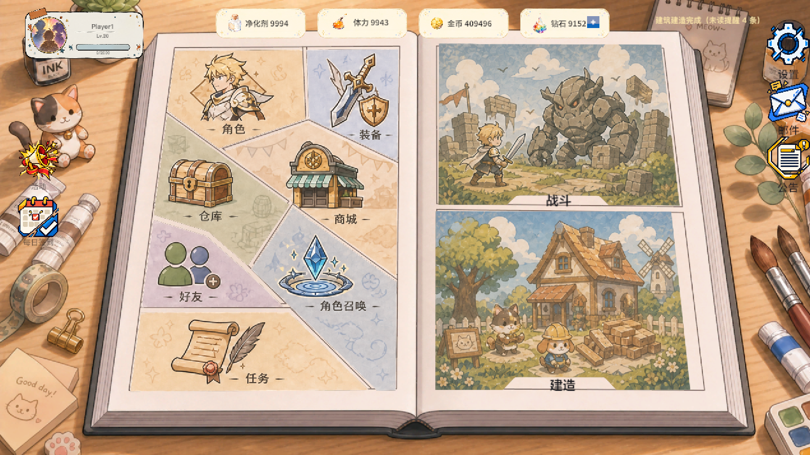

# 书屿梦行游戏软件 V1.0

## 用户操作说明书（修订工作稿）

软件名称：书屿梦行游戏软件  
软件版本：V1.0  
文档类型：用户操作说明书  
编制日期：2026 年 9 月  

> 本稿依据当前 Unity 客户端和正在运行的 V1.0.0 后端功能整理。带有“插图位置”的方框用于指导正式界面截图拍摄与替换；完成替换后，应删除方框中的拍摄说明，仅保留清晰截图及图题。

## 1. 软件概述

### 1.1 软件用途

书屿梦行游戏软件是一款以手账式书页为主要界面载体的经营与冒险游戏。用户登录后，可以在首页查看角色和资源状态，进入经营地图管理地块与建筑，也可以使用仓库、伙伴、装备、任务、商城、好友、邮件以及挂机冒险等功能。

### 1.2 主要功能

- 用户账号注册、账号登录和微信登录。
- 隐私政策查看、同意和账号隐私管理。
- 首页导航、资源信息和个人资料查看。
- 经营场景切换、地块购买与净化。
- 建筑建造、升级、移动、拆除和生产收取。
- 仓库物品查看、伙伴培养和装备管理。
- 挂机冒险、队伍编成、关卡战斗和奖励领取。
- 任务、成就、签到、商城和资源出售。
- 好友申请、好友赠礼、邮件和通知查看。

### 1.3 适用用户

本说明书面向首次使用书屿梦行游戏软件的普通用户，用于说明软件启动、登录以及各主要功能的操作方法。

## 2. 运行环境与启动

### 2.1 运行条件

1. 使用能够正常运行微信小程序或小游戏的移动终端。
2. 微信客户端及基础库版本满足正式发布包在微信公众平台设置的最低运行要求。
3. 设备能够正常连接互联网，以便完成登录、数据同步和游戏操作。
4. 建议在网络稳定、存储空间充足的环境下运行。

### 2.2 启动软件

1. 在微信中打开书屿梦行游戏软件的正式发布入口。
2. 软件启动后检查运行版本和服务状态。
3. 若系统提示版本更新，请按提示完成更新后重新进入。
4. 若系统处于维护状态，请在维护结束后再次启动。
5. 正常启动后进入登录页面。

## 3. 登录与首次使用

### 3.1 查看并同意隐私政策

首次登录前，用户可以点击登录页面中的隐私政策入口查看政策内容。阅读后勾选同意选项，再继续登录或注册。未完成必要授权时，软件会提示用户先阅读并确认相关内容。

### 3.2 账号注册

1. 在登录页面输入拟使用的账号和密码。
2. 在昵称输入区域填写游戏昵称。
3. 勾选隐私政策同意选项。
4. 点击“注册并登录”。
5. 注册成功后，系统进入游戏；若资料需要补充，按页面提示完成后重新登录。

### 3.3 账号登录

1. 输入已注册的账号和密码。
2. 勾选隐私政策同意选项。
3. 点击“登录”。
4. 登录成功后进入游戏首页。

### 3.4 微信登录

1. 点击“微信登录”。
2. 按微信授权页面提示完成授权。
3. 首次使用时，根据页面提示填写昵称或完成必要信息确认。
4. 登录成功后进入游戏首页。

> 插图位置——图 1“登录与隐私确认界面”。操作路径：启动软件 → 登录页。画面应同时显示账号、密码、昵称输入区域，登录、注册并登录、微信登录按钮，以及隐私政策查看和同意入口。对应正式文件名：`01-login-and-privacy.png`。拍摄时不得出现开发工具、测试地址、文件选择框或个人聊天窗口。

## 4. 首页和资源信息

### 4.1 首页组成

登录后进入首页。首页左上方显示头像、昵称和等级等用户信息，顶部资源栏显示当前主要资源数量。页面中央和两侧提供角色、装备、仓库、商城、好友、角色召唤、任务、战斗、建造、设置和邮件等功能入口。

### 4.2 查看资源

1. 在首页顶部查看净化剂、体力、金币和钻石等资源。
2. 资源数量发生变化后，页面会同步显示最新结果。
3. 若操作后数据未及时刷新，可返回首页或重新进入相关页面。

### 4.3 进入功能页面

点击首页相应图标即可进入对应功能。进入子页面后，可使用返回按钮回到首页。

图 2 首页和资源栏

## 5. 经营地图与地块

### 5.1 进入经营地图

在首页点击“建造”进入经营地图。地图以书页形式展示可使用地块、已建设地块和未解锁地块。页面还提供返回首页、任务、仓库、设置以及一键收取等入口。

> 插图位置——图 3“经营地图总览”。操作路径：首页 → 建造。画面应显示完整经营地图、可用地块、已建设地块、未解锁地块以及页面主要操作入口。对应正式文件名：`03-management-map.png`。当前参考文件：`Screenshots/04-management-map-reference.png`，仅用于确认构图；正式拍摄前必须移除右下角生成平台水印并统一中文按钮。

### 5.2 切换经营场景

1. 在经营地图中打开场景选择入口。
2. 查看已开放的经营场景。
3. 选择目标场景并确认切换。
4. 系统加载并显示目标场景中的地块和建筑状态。

### 5.3 购买和净化地块

1. 点击尚未开放的地块。
2. 查看开放条件和所需资源。
3. 资源充足时确认购买或净化。
4. 操作成功后，地块变为可建设状态。

> 插图位置——图 4“地块净化确认”。操作路径：首页 → 建造 → 选择未净化地块。画面应显示地块状态、消耗资源、确认和取消按钮。对应正式文件名：`04-land-purification.png`。当前参考文件：`Screenshots/05-land-purification-reference.png`，仅用于确认弹窗位置；正式拍摄前必须将英文和内部物品键替换为正式中文显示，并移除水印。

## 6. 建筑与生产

### 6.1 建造建筑

1. 在经营地图中选择可建设地块。
2. 点击建造按钮，查看可建建筑列表。
3. 选择建筑并查看建造条件、资源消耗和所需时间。
4. 条件满足时确认建造。
5. 建造完成后点击完成按钮，使建筑进入可使用状态。

### 6.2 查看建筑详情

点击已建成建筑，可以查看建筑名称、等级、状态、生产信息和入驻伙伴等内容。建筑详情页提供升级、移动、拆除、伙伴入驻以及生产相关操作。

### 6.3 升级、移动和拆除

1. 点击已建成建筑打开详情。
2. 点击“升级”查看升级条件，确认后开始升级。
3. 点击“移动”后选择目标空地，确认后完成位置调整。
4. 点击“拆除”时再次确认，确认后移除建筑。
5. 拆除属于不可逆操作，操作前应核对建筑和页面提示。

### 6.4 生产与收取

1. 打开具有生产能力的建筑。
2. 查看当前配方、工作时间和预计产出。
3. 如页面支持配方切换，选择目标配方并确认。
4. 生产完成后点击收取，将产物加入仓库。
5. 经营地图提供一键收取入口时，可收取当前场景内已完成的产物。

> 插图位置——图 5“建筑详情与生产操作”。操作路径：首页 → 建造 → 选择已完成建筑。画面应显示建筑名称、等级、生产进度或产出，以及升级、移动、拆除、伙伴入驻、配方和收取等当前可用按钮。对应正式文件名：`05-building-production.png`。当前参考文件：`Screenshots/06-building-detail-reference.png`，仅用于核对布局；正式拍摄前必须统一中英文、修复文本遮挡并移除水印。

## 7. 仓库、伙伴与装备

### 7.1 查看仓库

1. 在首页点击“仓库”，或在经营地图点击仓库入口。
2. 查看已获得的资源、材料和道具。
3. 选择物品后查看名称、数量和用途说明。
4. 返回上一页继续其他操作。

> 插图位置——图 6“仓库物品列表”。操作路径：首页 → 仓库。画面应显示物品分类、物品图标、名称、数量和详情区域。对应正式文件名：`06-inventory.png`。正式成片应使用当前账号的非敏感测试数据，不显示调试面板。

### 7.2 查看和培养伙伴

1. 在首页点击“角色”。
2. 从伙伴列表中选择目标伙伴。
3. 查看伙伴等级、属性和当前装备。
4. 资源满足时执行升级或自动升级。
5. 操作完成后查看更新后的等级和属性。

### 7.3 管理装备

1. 在首页点击“装备”，或在伙伴详情中进入装备区域。
2. 选择装备并查看属性和强化信息。
3. 资源满足时执行升级或自动升级。
4. 确认操作结果并返回伙伴页面。

> 插图位置——图 7“伙伴与装备”。操作路径：首页 → 角色 → 选择伙伴，或首页 → 装备。建议以一张组合图展示伙伴详情和装备详情，文字必须完整清晰。对应正式文件名：`07-partner-equipment.png`。

### 7.4 角色召唤

1. 在首页点击“角色召唤”。
2. 查看当前召唤内容、消耗和可能获得的奖励。
3. 选择单次或多次召唤并确认。
4. 在结果页面查看获得的角色或资源。

> 插图位置——图 8“角色召唤”。操作路径：首页 → 角色召唤。画面应显示正式中文标题、召唤内容、消耗、概率说明入口和召唤按钮。对应正式文件名：`08-character-summon.png`。当前乱码参考文件：`Screenshots/13-summon-garbled-reference-do-not-submit.png`，只能用于定位整改问题，严禁作为申报截图。

## 8. 挂机冒险

### 8.1 进入挂机冒险

在首页点击“战斗”进入挂机冒险页面。页面显示当前关卡进度、体力、可用伙伴、队伍编成和挂机奖励状态。

### 8.2 编成队伍

1. 打开队伍编成区域。
2. 选择可用伙伴并放入队伍位置。
3. 可使用自动编成快速生成队伍，也可以清空后重新选择。
4. 保存编成结果。

### 8.3 开始关卡

1. 选择可挑战关卡。
2. 核对队伍和体力状态。
3. 点击开始按钮进入战斗。
4. 战斗过程中查看双方状态、回合进展和技能效果。
5. 关卡结束后查看通关结果和奖励。

### 8.4 领取挂机奖励

1. 返回挂机冒险首页。
2. 查看当前累计时间和可领取奖励。
3. 点击领取，将奖励加入账号资源或仓库。

> 插图位置——图 9“挂机冒险与队伍编成”。操作路径：首页 → 战斗。画面应显示关卡、体力、队伍位置、可用伙伴和挂机奖励入口。对应正式文件名：`09-idle-adventure-home.png`。

> 插图位置——图 10“关卡战斗界面”。操作路径：首页 → 战斗 → 编成队伍 → 开始关卡。画面应显示双方角色、生命或状态信息、回合进展和战斗操作区域。对应正式文件名：`10-battle.png`。

## 9. 任务、成就与签到

### 9.1 查看任务

1. 在首页或经营地图点击“任务”。
2. 查看任务名称、目标、当前进度和奖励。
3. 完成目标后返回任务页面领取奖励。
4. 奖励领取成功后，任务状态更新。

### 9.2 查看成就

进入成就区域，查看长期目标和完成进度。达到条件后点击领取，将奖励加入账号。

### 9.3 每日签到

1. 打开签到页面。
2. 查看当日及后续签到奖励。
3. 点击当日签到按钮领取奖励。
4. 已领取日期显示为完成状态。

> 插图位置——图 11“任务或签到奖励”。操作路径：首页 → 任务，或首页相关活动入口 → 签到。建议展示任务进度和可领取奖励；若使用签到页，应完整显示日期和领取状态。对应正式文件名：`11-task-or-sign-in.png`。

## 10. 商城与资源出售

### 10.1 使用商城

1. 在首页点击“商城”。
2. 浏览商品或资源兑换项目。
3. 选择目标项目，查看价格、数量和说明。
4. 确认购买或兑换。
5. 操作成功后，资源数量和相关物品状态更新。

### 10.2 出售资源

1. 进入资源出售页面。
2. 选择准备出售的资源。
3. 输入或调整出售数量。
4. 查看预计获得内容并确认出售。
5. 出售完成后检查资源和所得数量。

> 插图位置——图 12“商城或资源出售”。操作路径：首页 → 商城 → 选择商品，或商城 → 资源出售。画面应显示商品名称、数量、价格和确认操作。对应正式文件名：`12-shop-or-sell.png`。

## 11. 好友、邮件与通知

### 11.1 好友管理

1. 在首页点击“好友”。
2. 查看好友列表和好友申请。
3. 可按页面提示发送、接受或拒绝好友申请。
4. 选择好友后查看可用互动功能。

### 11.2 好友赠礼

1. 在好友页面选择目标好友。
2. 点击赠礼入口并选择可赠送内容。
3. 核对好友和礼物后确认赠送。
4. 赠送成功后查看页面提示。

### 11.3 邮件与通知

1. 在首页点击“邮件”。
2. 查看邮件标题、发送时间和阅读状态。
3. 点击邮件查看正文。
4. 邮件含附件时，点击领取后检查奖励到账情况。
5. 点击通知入口可查看系统通知，并按提示进入相关功能。

> 插图位置——图 13“好友或邮件”。操作路径：首页 → 好友，或首页 → 邮件。建议优先拍摄邮件正文和附件领取界面；如好友赠礼是申报功能重点，可使用好友赠礼确认界面。对应正式文件名：`13-friend-or-mail.png`。不得显示真实微信昵称、头像、聊天内容或其他个人信息。

## 12. 个人资料、设置与隐私

### 12.1 查看个人资料

点击首页头像或个人资料入口，查看昵称、头像、等级等账号信息。页面提供头像或资料修改功能时，可按提示选择并保存。

### 12.2 游戏设置

1. 点击首页或经营地图的设置图标。
2. 查看声音、提示和其他可用设置项。
3. 调整选项后保存或返回，设置立即或在下次进入时生效。
4. 需要切换账号时，使用退出或切换登录入口返回登录页。

### 12.3 隐私与账号管理

1. 在登录页或账号管理页查看当前隐私政策。
2. 按页面提示完成隐私授权或撤回授权。
3. 需要注销账号时，点击“申请注销”并确认。
4. 注销申请进入冷静期后，可在允许的时间内撤销申请。
5. 授权或账号状态发生变化后，按提示重新登录。

> 插图位置——图 14“个人资料与隐私管理”。操作路径：首页 → 头像或设置 → 账号管理。画面应显示用户资料及隐私政策、撤回授权、申请注销或撤销注销等当前可用入口。对应正式文件名：`14-profile-privacy.png`。截图必须使用正式中文隐私政策，不得出现本地开发声明、测试邮箱或内部版本号。

## 13. 常见问题

### 13.1 无法登录

请检查网络连接、账号和密码是否正确，并确认已阅读和同意隐私政策。若系统提示维护或版本过低，请按提示稍后重试或完成更新。

### 13.2 微信登录未完成

请确认当前微信客户端可以正常使用，并根据授权页面完成操作。取消授权后，可返回登录页重新点击微信登录。

### 13.3 资源或页面状态未及时更新

可先返回首页后重新进入相关页面。网络恢复后仍未更新时，可退出并重新登录。

### 13.4 无法购买、净化或建造

请检查地块状态、前置条件和资源数量。条件不足时，页面会显示相应提示。

### 13.5 建筑没有产出

请确认建筑已经完成建造、具备生产能力并满足当前配方条件。生产尚未结束时，需要等待完成后再收取。

### 13.6 无法开始冒险

请检查队伍是否已编成、体力是否充足以及关卡是否开放。调整后重新开始。

### 13.7 奖励未显示

请返回首页或仓库刷新显示。若重复操作仍无结果，记录发生时间和页面提示后联系运营支持。

### 13.8 如何保护账号信息

不要向他人透露账号密码或验证码，不要使用来源不明的客户端入口。涉及隐私和账号注销的操作，应仔细阅读页面说明后再确认。

## 14. 插图位置与对应文件清单

| 图号 | 插入章节 | 对应正式文件名 | 当前对应材料 | 正式成片要求 |
| --- | --- | --- | --- | --- |
| 图 1 | 3.4 微信登录之后 | `01-login-and-privacy.png` | 尚无可用成片 | 登录、注册、微信登录、隐私入口同屏；不得出现开发窗口 |
| 图 2 | 4.3 进入功能页面之后 | `02-home.png` | `Screenshots/03-home-reference.png` | 首页入口与资源栏清晰；确认软件名称与版本后可复核使用 |
| 图 3 | 5.1 进入经营地图之后 | `03-management-map.png` | `Screenshots/04-management-map-reference.png` | 移除平台水印，按钮和状态全部中文化 |
| 图 4 | 5.3 购买和净化地块之后 | `04-land-purification.png` | `Screenshots/05-land-purification-reference.png` | 正式中文资源名、消耗、确认和取消按钮 |
| 图 5 | 6.4 生产与收取之后 | `05-building-production.png` | `Screenshots/06-building-detail-reference.png` | 修复遮挡、中英文混排和平台水印 |
| 图 6 | 7.1 查看仓库之后 | `06-inventory.png` | 尚无可用成片 | 物品名称、数量和详情完整 |
| 图 7 | 7.3 管理装备之后 | `07-partner-equipment.png` | 尚无可用成片 | 伙伴属性和装备属性清晰 |
| 图 8 | 7.4 角色召唤之后 | `08-character-summon.png` | `Screenshots/13-summon-garbled-reference-do-not-submit.png` | 必须先修复乱码，再使用正式中文界面拍摄 |
| 图 9 | 8.4 领取挂机奖励之前 | `09-idle-adventure-home.png` | 尚无可用成片 | 关卡、体力、队伍和挂机奖励状态完整 |
| 图 10 | 8.4 领取挂机奖励之前 | `10-battle.png` | 尚无可用成片 | 双方角色、状态和战斗过程清晰 |
| 图 11 | 9.3 每日签到之后 | `11-task-or-sign-in.png` | 尚无可用成片 | 任务进度或签到状态与奖励完整 |
| 图 12 | 10.2 出售资源之后 | `12-shop-or-sell.png` | 尚无可用成片 | 商品、数量、价格和确认操作完整 |
| 图 13 | 11.3 邮件与通知之后 | `13-friend-or-mail.png` | 尚无可用成片 | 使用匿名测试数据，不显示个人信息 |
| 图 14 | 12.3 隐私与账号管理之后 | `14-profile-privacy.png` | 尚无可用成片 | 使用正式隐私政策和正式运营主体信息 |

正式成片应仅保留游戏画面，分辨率和比例保持一致，文字清晰可辨。不得包含 Unity 编辑器、浏览器地址栏、桌面、文件选择框、调试面板、测试接口、本地开发声明、个人聊天窗口、乱码、素材平台水印或与书屿梦行无关的内容。

