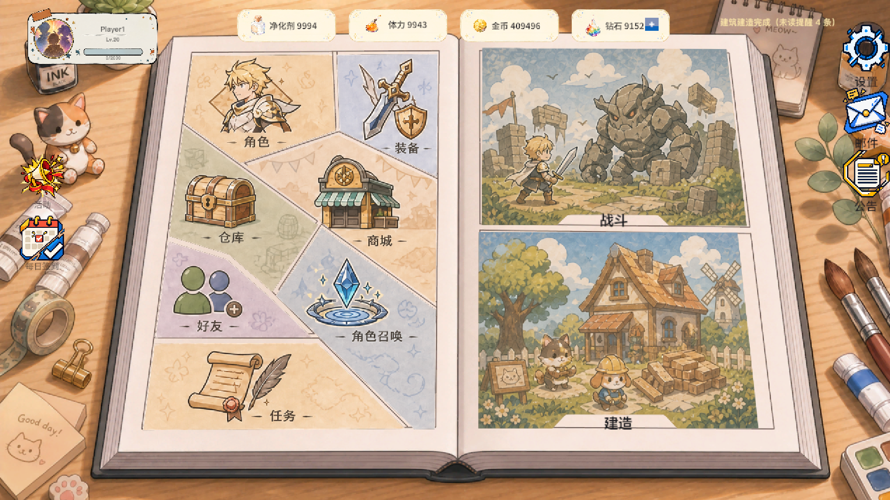
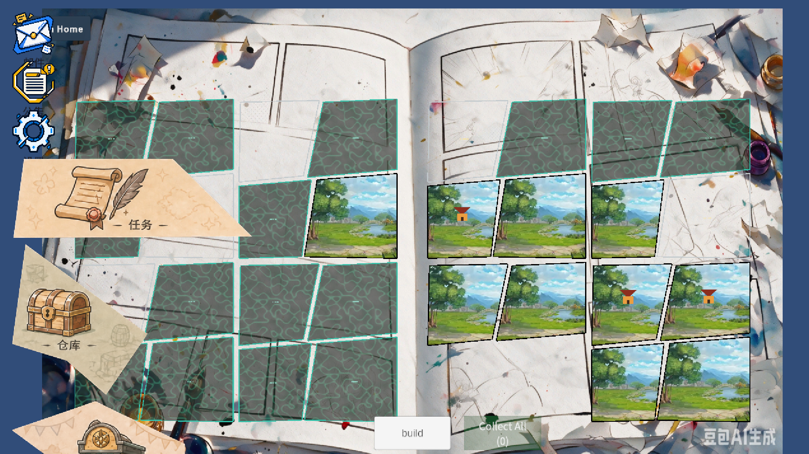
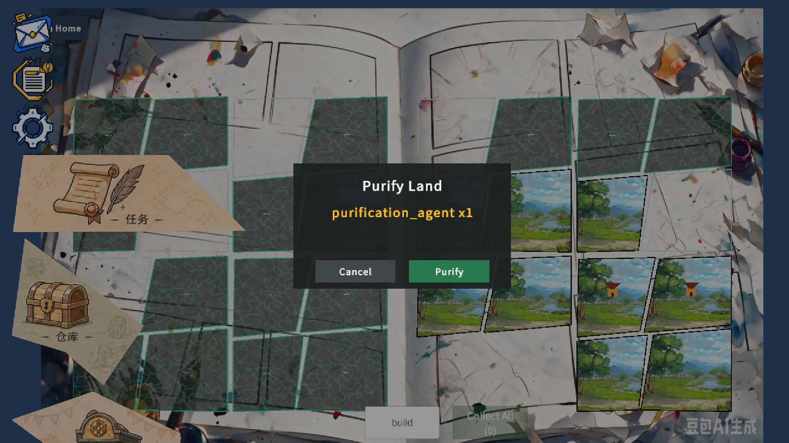
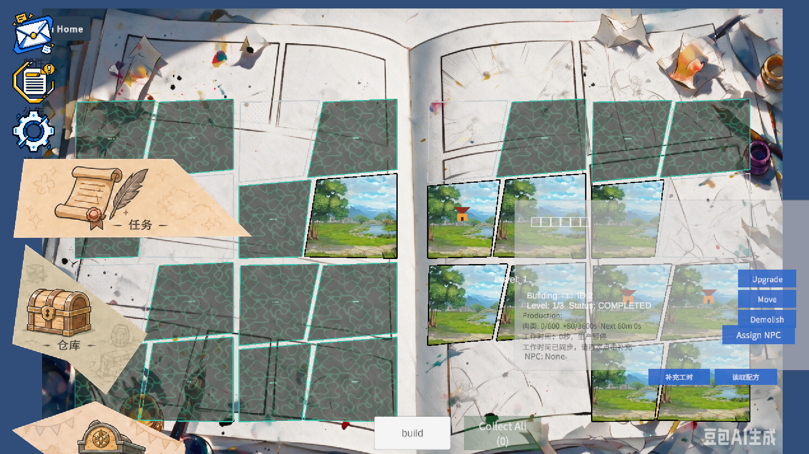
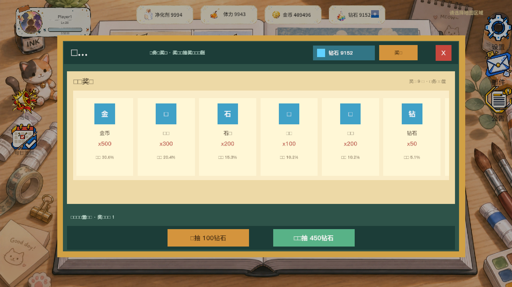

# 书屿梦行游戏软件 V1.0 用户手册材料审查报告

审查对象：`D:\pi\书屿梦行游戏软件V1.0-用户操作说明书.docx`  
前端范围：当前工作区 `master` Unity 项目  
后端范围：本机当前可通过 `127.0.0.1:8080` 访问的 V1.0.0 服务  
审查日期：2026 年 9 月 1 日  

## 一、审查结论

原用户手册目前**不符合直接提交软件著作权登记的稳妥材料条件**，建议完成本报告所列整改后再作为文档鉴别材料提交。主要原因不是章节数量不足，而是原文件没有任何真实界面截图，仍保留大量配图占位和编写提示，并且部分表述与当前客户端、当前运行后端或实际可拍摄界面不一致。

本次已按当前“书屿梦行”项目独立整理修订稿，没有引入其他项目的世界观、角色、战斗设定或素材。修订稿可以作为最终用户手册的正文基础，但在补齐并替换正式截图前，仍属于工作稿，不应直接提交。

## 二、适用材料要求与判断口径

根据现有申请材料清单中的文档鉴别材料要求，用户手册可作为软件著作权登记的文档材料。审查时应重点满足以下条件：

1. 软件名称和版本号与申请表、源程序材料及软件运行界面一致。
2. 文档不足 60 页时提交全部；达到或超过 60 页时通常按规定提交前、后连续页。
3. 普通文字页应保持足够的信息密度，图文页可根据截图和说明合理排版。
4. 使用 A4 纵向、从左到右排版，页眉包含软件名称和版本号，页脚有连续页码。
5. 内容能够说明软件用途、运行方式、主要功能和实际操作流程。
6. 截图应来自申请版本的真实运行界面，清晰、连续，并与文字说明相互对应。

“至少 10 张截图”属于现有清单中游戏版号材料的数量要求，不能直接当作软件著作权用户手册的法定最低截图数量。本项目建议保留 14 张核心流程图，是为了覆盖当前主要功能并提高材料一致性，不是声称软著登记存在固定 14 张或 10 张的硬性门槛。最终受理尺度以登记机构和代办审核意见为准。

## 三、原文件检查结果

### 3.1 已具备的基础条件

- 原文件为 DOCX，采用 A4 纵向排版。
- 标题、软件名称和 V1.0 版本信息较完整。
- 有页眉和页脚，页脚包含页码。
- 已编写软件概述、运行环境、登录、经营、生产、冒险、社交、隐私和常见问题等章节。
- 文档篇幅不足 60 页时，可以按全部文档提交，不需要人为扩充到 60 页。

### 3.2 阻止直接提交的问题

1. DOCX 压缩包中不存在 `word/media`，正文图片数量为 0。
2. 正文有 26 处“配图提示”或截图占位，但没有一张真实界面图。
3. 仍包含“须与申请表一致”“后续可再润色”“以后端配置为准”和复选框式整理提示，这些属于编写过程信息。
4. 原稿只突出微信登录，没有完整反映当前客户端同时提供账号登录、注册并登录和微信登录。
5. 多处写入“幂等保护”“服务器计算全部战斗”等技术实现细节，不属于普通用户操作说明。
6. 部分功能虽有服务端接口，但当前客户端没有稳定、清晰、可直接拍摄的完整中文页面，不能仅凭接口存在写成已完成申报截图。
7. 微信最低基础库写成“2.0.3 及以上”不能完整覆盖当前好友赠礼能力；正式手册应以发布包在平台设置的最低要求为准，若申报范围包含当前好友赠礼能力，应按该能力要求复核，`D:/weijun-game-project-branches/sck/src/main/java/com/game/server/modules/wechatgift/service/WechatFriendGiftCatalogService.java:41` 的当前口径为 3.11.2。

## 四、当前前端与后端核对结果

### 4.1 前端身份与发布配置

当前 Unity 项目设置存在以下申报风险：

- `ProjectSettings/ProjectSettings.asset:15` 的公司名仍为 `DefaultCompany`。
- `ProjectSettings/ProjectSettings.asset:16` 的产品名仍为 `My project (2)`。
- `ProjectSettings/ProjectSettings.asset:144` 的包版本为 `1.0`。
- `Assets/_Imported/weijun-game-project/Assets/Resources/ApiConfig.json:2` 的开发地址为本机地址。
- `Assets/_Imported/weijun-game-project/Assets/Resources/ApiConfig.json:3` 的生产地址为空。

因此，提交前必须统一最终登记名称、Unity 产品名、发布包展示名称、版本号、源程序材料页眉和用户手册页眉，并配置真实生产服务地址。当前修订稿统一使用“书屿梦行游戏软件 V1.0”，但这不能替代项目发布配置本身的整改。

### 4.2 登录、隐私和账号管理

当前客户端明确包含三类登录入口：

- `Assets/_Imported/weijun-game-project/Assets/Scripts/GameBoot.cs:141` 绑定账号登录。
- `Assets/_Imported/weijun-game-project/Assets/Scripts/GameBoot.cs:142` 绑定注册。
- `Assets/_Imported/weijun-game-project/Assets/Scripts/GameBoot.cs:143` 绑定微信登录。
- `Assets/_Imported/weijun-game-project/Assets/Scripts/GameBoot.cs:487` 实现账号登录流程。
- `Assets/_Imported/weijun-game-project/Assets/Scripts/GameBoot.cs:504` 实现注册流程。
- `Assets/_Imported/weijun-game-project/Assets/Scripts/GameBoot.cs:530` 实现微信登录流程。

隐私和账号状态也已有客户端流程：

- `Assets/_Imported/weijun-game-project/Assets/Scripts/GameBootCompliance.cs:243` 显示隐私政策。
- `Assets/_Imported/weijun-game-project/Assets/Scripts/GameBootCompliance.cs:630` 提交隐私同意。
- `Assets/_Imported/weijun-game-project/Assets/Scripts/GameBootCompliance.cs:698` 处理撤回授权。
- `Assets/_Imported/weijun-game-project/Assets/Scripts/GameBootCompliance.cs:767` 处理申请注销结果。
- `Assets/_Imported/weijun-game-project/Assets/Scripts/GameBootCompliance.cs:812` 处理撤销注销结果。

原手册已据此修订为账号注册、账号登录、微信登录、隐私同意、撤回授权和注销冷静期等用户可观察流程。

### 4.3 经营、生产和冒险

当前客户端服务层能确认以下流程：

| 功能 | 当前客户端证据 | 修订稿处理 |
| --- | --- | --- |
| 库存刷新 | `Assets/_Project/Scripts/Networking/BackendGameService.cs:272` | 保留仓库查看 |
| 地图同步 | `Assets/_Project/Scripts/Networking/BackendGameService.cs:282` | 保留经营地图 |
| 地块购买 | `Assets/_Project/Scripts/Networking/BackendGameService.cs:312` | 保留购买操作 |
| 地块净化 | `Assets/_Project/Scripts/Networking/BackendGameService.cs:324` | 保留净化操作 |
| 建筑建造 | `Assets/_Project/Scripts/Networking/BackendGameService.cs:336` | 保留建造操作 |
| 建筑升级 | `Assets/_Project/Scripts/Networking/BackendGameService.cs:396` | 保留升级操作 |
| 建筑拆除 | `Assets/_Project/Scripts/Networking/BackendGameService.cs:411` | 增加不可逆提示 |
| 建筑移动 | `Assets/_Project/Scripts/Networking/BackendGameService.cs:421` | 保留移动操作 |
| 生产收取 | `Assets/_Project/Scripts/Networking/BackendGameService.cs:431` | 保留单体收取 |
| 一键收取 | `Assets/_Project/Scripts/Networking/BackendGameService.cs:478` | 保留场景收取 |
| 冒险首页 | `Assets/_Project/Scripts/Networking/BackendGameService.cs:533` | 保留挂机冒险首页 |
| 队伍编成 | `Assets/_Project/Scripts/Networking/BackendGameService.cs:544` | 保留编成操作 |
| 开始战斗 | `Assets/_Project/Scripts/Networking/BackendGameService.cs:588` | 保留关卡战斗 |
| 挂机奖励 | `Assets/_Project/Scripts/Networking/BackendGameService.cs:764` | 保留奖励领取 |
| 伙伴列表 | `Assets/_Project/Scripts/Networking/BackendGameService.cs:821` | 保留伙伴查看 |
| 伙伴入驻 | `Assets/_Project/Scripts/Networking/BackendGameService.cs:831` | 归入建筑详情 |

服务层存在不代表申报截图已经合格。修订稿只保留用户能够理解的操作结果，删除接口路径、请求键、服务端计算和幂等实现等内部内容。

### 4.4 当前运行后端

本次核验时，`http://127.0.0.1:8080/api/health` 返回服务状态 `UP`、服务版本 `1.0.0`。当前监听服务来自本机 `sck` 工作目录构建的 JAR，因此本文的后端判断以该正在运行的服务为准，而不是根据其他后端目录推测。

当前隐私政策接口返回的是本地联调内容：

- 标题：`Local Development Privacy Notice`
- 摘要：`For local SCK and Unity integration only. Not for production use.`
- 正文明确包含：`This notice must not be published to production.`
- 运营主体为 `Local Development`，联系邮箱为无效测试邮箱。

这套隐私内容只能用于本地接口联调，不能进入申报截图或正式发布包。必须先在正式后端配置真实运营主体、联系方式、生效时间、政策版本和中文隐私正文，再拍摄图 1 和图 14。

## 五、运行界面截图审查

### 5.1 已截取的参考画面

本次从当前 Unity Game 视图裁出以下参考图，裁剪结果不包含 Unity 的 Hierarchy、Project 等编辑器面板：

| 文件 | 当前状态 | 是否可直接用于申报 |
| --- | --- | --- |
| `Screenshots/03-home-reference.png` | 首页和资源栏完整、无编辑器边框 | 可在核对软件名称、版本和测试数据后作为候选 |
| `Screenshots/04-management-map-reference.png` | 经营地图构图完整，但右下角有生成平台水印 | 否 |
| `Screenshots/05-land-purification-reference.png` | 有净化弹窗，但弹窗使用英文和内部资源键，且有水印 | 否 |
| `Screenshots/06-building-detail-reference.png` | 有建筑详情，但存在英文按钮、文本遮挡和水印 | 否 |
| `Screenshots/13-summon-garbled-reference-do-not-submit.png` | 召唤界面存在严重乱码 | 严禁使用 |

首页候选画面：

经营地图构图参考，水印未处理：

地块净化弹窗参考，英文和内部资源键未处理：

建筑详情布局参考，中英文混排、遮挡和水印未处理：

角色召唤乱码整改证据，严禁作为申报截图：

### 5.2 正式截图统一要求

1. 只截取游戏画面，不包含 Unity 编辑器边框、桌面、任务栏、浏览器地址栏或微信聊天窗口。
2. 使用同一正式构建、同一分辨率和同一画面比例，建议保留 16:9 原图。
3. 文字必须清晰、完整、全部使用正式中文，不得出现方框乱码和内部资源键。
4. 不得出现“豆包AI生成”或其他素材、生成平台水印。
5. 使用匿名申报测试账号，不出现真实姓名、手机号、微信昵称、头像或聊天内容。
6. 不显示本机地址、开发服务器、测试邮箱、分支名、提交号和调试面板。
7. 截图顺序应与手册操作顺序一致，图题和正文功能名称保持一致。

### 5.3 截图位置和对应成片

| 图号 | 手册插入位置 | 操作路径 | 正式文件名 | 当前处理结论 |
| --- | --- | --- | --- | --- |
| 图 1 | 3.4 之后 | 启动 → 登录页 → 查看隐私政策 | `01-login-and-privacy.png` | 正式隐私政策配置后拍摄 |
| 图 2 | 4.3 之后 | 登录 → 首页 | `02-home.png` | 可参考现有首页图 |
| 图 3 | 5.1 之后 | 首页 → 建造 | `03-management-map.png` | 移除水印、统一中文后重拍 |
| 图 4 | 5.3 之后 | 建造 → 选择未净化地块 | `04-land-purification.png` | 中文化弹窗后重拍 |
| 图 5 | 6.4 之后 | 建造 → 选择已建建筑 | `05-building-production.png` | 修复遮挡、英文和水印后重拍 |
| 图 6 | 7.1 之后 | 首页 → 仓库 | `06-inventory.png` | 补拍 |
| 图 7 | 7.3 之后 | 首页 → 角色/装备 | `07-partner-equipment.png` | 补拍 |
| 图 8 | 7.4 之后 | 首页 → 角色召唤 | `08-character-summon.png` | 乱码修复后重拍 |
| 图 9 | 8.4 之前 | 首页 → 战斗 | `09-idle-adventure-home.png` | 补拍 |
| 图 10 | 8.4 之前 | 战斗 → 编成 → 开始关卡 | `10-battle.png` | 补拍 |
| 图 11 | 9.3 之后 | 首页 → 任务或签到 | `11-task-or-sign-in.png` | 补拍 |
| 图 12 | 10.2 之后 | 首页 → 商城 → 商品或出售 | `12-shop-or-sell.png` | 补拍 |
| 图 13 | 11.3 之后 | 首页 → 好友或邮件 | `13-friend-or-mail.png` | 使用匿名数据补拍 |
| 图 14 | 12.3 之后 | 首页 → 设置/资料 → 账号管理 | `14-profile-privacy.png` | 正式隐私政策配置后拍摄 |

## 六、必须完成的整改

### 6.1 申报前阻断项

1. 将 Unity 产品名从 `My project (2)` 改为最终登记名称，并统一版本号。
2. 配置正式生产服务地址，不使用空生产地址或本机开发地址构建申报版本。
3. 把本地英文隐私声明替换为正式中文隐私政策和真实运营主体信息。
4. 修复角色召唤页面的乱码。
5. 将地块净化、建筑详情等页面的英文和内部键名改为正式中文。
6. 修复建筑详情中的文本遮挡和布局问题。
7. 移除经营场景中的生成平台水印，替换为权属清晰的无水印素材。
8. 按图 1 至图 14 拍摄并插入真实运行截图。
9. 替换完成后，删除修订稿中的拍摄说明方框，只保留图像和图题。

### 6.2 一致性复核项

1. 申请表、源代码页眉、用户手册页眉、Unity 产品名和发布包名称完全一致。
2. 申请版本均使用 V1.0 或统一的最终版本格式，不混用 V1.0、1.0 和 1.0.0 作为登记名称版本。
3. 正文功能范围不超过最终发布包实际可操作范围。
4. 如果最终版本不开放某项功能，应删除对应章节和截图位，而不是仅凭服务端接口保留。
5. 若包含好友赠礼，按微信当前能力要求复核最低基础库，并与平台发布设置一致。
6. 所有截图使用同一版本、同一匿名测试账号和相近时间拍摄。

## 七、修订稿改动说明

本次修订已经完成以下内容：

- 将登录流程改为账号注册、账号登录和微信登录三种实际入口。
- 增加隐私政策、撤回授权、申请注销和撤销注销的用户操作说明。
- 将经营地图、地块、建筑、生产、仓库、伙伴、装备、挂机冒险、任务、签到、商城、好友、邮件和通知按用户路径重组。
- 删除或改写服务端计算、接口配置、幂等保护等内部实现描述。
- 将原来的 26 个散乱配图提示收敛为 14 个核心截图位。
- 为每个截图位指定图号、章节位置、操作路径、画面要求、正式文件名和当前参考材料。
- 保留 A4、页眉软件名与版本、页脚页码的成稿要求。

## 八、最终提交检查表

- [ ] 软件登记名称已最终确认。
- [ ] Unity 产品名、发布包名和手册名称已统一。
- [ ] V1.0 版本格式已在全部材料中统一。
- [ ] 正式生产接口已配置并可用。
- [ ] 正式中文隐私政策已上线。
- [ ] 乱码、英文内部键、遮挡和水印已处理。
- [ ] 14 张核心截图已按清单拍摄并插入。
- [ ] 图号、图题、正文操作与截图完全对应。
- [ ] 文档中不含开发地址、分支、提交号、测试账号或调试信息。
- [ ] 文档中不含编写提示、复选框和未来态说明。
- [ ] 页眉有软件名称和版本，页脚页码连续。
- [ ] DOCX 解包后存在实际图片文件，且图片清晰。
- [ ] 最终从头到尾人工通读一次，并使用正式构建逐步复现。
